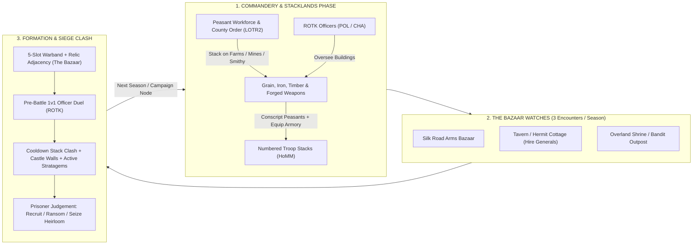

# 🐅 TIGER TALLY: Mandate of Chaos (虎符：乱世天命)
### Deep Game Design Architecture — Five-Game Synthesis

> [!IMPORTANT]
> **Core Design Thesis**: Most mashups fail because they bolt separate minigames together. **Tiger Tally** unifies all five inspirations into **one unbroken causal chain**: *Lords of the Realm II*'s peasant-and-armory economy is manipulated via *Stacklands*' tactile card-stacking, paced by *The Bazaar*'s crisp 3-Watch encounter & spatial-adjacency engine, commanded by *Romance of the Three Kingdoms* generals (WAR/INT/POL/CHA + Loyalty + 1v1 Duels), and fought with *Heroes of Might and Magic* numbered troop stacks & castle sieges.

---

## 1. Why These Five Games Complete Each Other

| Inspiration | What We Take (The Soul) | What Flaw Another Pillar Solves |
| :--- | :--- | :--- |
| **Lords of the Realm II** | **Peasant Happiness, Grain Rations, Taxes, & The Discrete Armory**: You don't magically buy "Pikemen" with gold—you harvest Grain, mine Iron/Timber, forge **Spears, Chu-Ko-Nu Crossbows, Armor, Horses, & Catapults**, and **Conscript** real peasants out of your workforce (hurting County Order!). | *Stacklands* turns LOTR2's spreadsheet sliders into tactile, satisfying physical cards on your Commandery table. |
| **Stacklands** | **Card-Stacking Production & Muster Recipes**: Stack `Peasants` onto `Rice Paddy` or `Iron Pit`; stack `Artisans + Iron` onto `Smithy` to forge Weapon Stacks; stack `Peasants + Weapons + Horses` onto the **Tiger Tally Muster Seal** to form/merge Army Stacks. | *The Bazaar*'s **Watch-based pacing** eliminates late-game *Stacklands* real-time card-clutter panic and starvation chaos. |
| **The Bazaar** | **3-Watch Seasonal Encounters & Left/Right Spatial Adjacency**: Each Season has 3 crisp Encounter Choices (Silk Merchant, Hermit Winehouse, Map Skirmish, Imperial Envoy). On your 5-Slot Warband Board, **positioning matters** (*"Haste adjacent Ranged stacks"*, *"Ignite neighbor's arrows"*, *"Shield Left & Right flanks"*). | *HoMM* & *LOTR2* give your Bazaar slots **living numbered soldier counts** and real economic weight instead of abstract item shop stat-sticks. |
| **Heroes of Might & Magic** | **Numbered Unit Stacks, Town Hall Upgrades, & Overland Campaign Nodes**: `36 Chu-Ko-Nu Marksmen` deal `36 × Base DMG`; casualties shrink the stack permanently; merging new recruits grows the stack. Upgrade Commandery structures (`Smithy → Imperial Arsenal`, `Watchtower → Citadel`) and visit Shrines/Granaries on the Act Map. | *ROTK* adds charismatic named Commanders attached directly to stacks, 1v1 Pre-Battle Duels, and prisoner defections. |
| **Romance of the Three Kingdoms** | **Named Officers (`WAR / INT / POL / CHA`), Loyalty, 1v1 Duels, Fire/Flood Stratagems, & Prisoner Fate**: High-`POL` officers oversee farms/smithies; high-`WAR` officers lead vanguard stacks and fight 1v1 Duels; high-`INT` Strategists fuel active Battle Stratagems; captured enemy generals can be **Recruited, Ransomed, or Executed for their Heirloom**. | *Roguelike Act Structure* distills a 60-hour Koei grand campaign into a razor-sharp, high-replayability 30–45 minute run. |

---

## 2. The Unified Causal Loop

---

## 3. Deep Mechanical Systems

### A. County Governance & The LOTR2 Economy
Every Season (Spring · Summer · Autumn · Winter), your Prefecture updates based on two *Lords of the Realm II* dials:
- **Rations (`Meager 0.5x` · `Normal 1.0x` · `Generous 1.5x` · `Feast 2.0x`)**: Feeds both Free Peasants and Mustered Soldiers. Running out of **Grain** causes Famine (Happiness `-25`, Army Desertion `-15%`!).
- **Tax Rate (`Benevolent 0%` · `Light 8%` · `Standard 15%` · `Tyrannical 25%`)**: Converts Population × `POL` bonus into **Gold Taels**, at the cost of County Order.
- **County Order / Happiness (`0–100`)**:
  - `≥ 75 (Prosperous)`: Refugees flock to your banner (`+10` to `+20` Free Peasants each Season!).
  - `40–74 (Stable)`: Normal growth (`+5` Peasants).
  - `< 35 (Unrest)`: Peasants emigrate or spawn Turban Brigands; Officer Loyalty wavers!
  - **Conscription Shock**: Drafting `10 Peasants` into the military permanently removes them from harvest labor *and* reduces Happiness by `-6` (mitigated by Lord `CHA` or Cao Cao's *Tuntian* doctrine).

### B. Stacklands Card Crafting & Muster Table
Drag-and-drop (or quick-stack click) cards on your **Commandery Worktable**:
1. **Resource Sites**:
   - `Terraced Rice Paddy` + `10 Peasants` → `+35 Grain` (`×1.5` in Autumn, `×0.5` in Winter; boosted by Overseer `POL`).
   - `Mountain Iron Vein` + `10 Peasants` → `+12 Iron Ingots`.
   - `Bamboo & Oak Forest` + `10 Peasants` → `+14 Seasoned Timber`.
   - `Northern Pasture` + `10 Peasants` + `10 Grain` → `+10 Warhorses`.
2. **Imperial Smithy Recipes** (Forges Armory Equipment in batches of `10`):
   - **Ash Longspears**: `6 Timber + 4 Iron`
   - **Chu-Ko-Nu Crossbows**: `8 Timber + 6 Iron`
   - **Lamellar Shields & Sabers**: `10 Iron + 4 Timber`
   - **Heavy Ji Halberds**: `12 Iron + 6 Timber`
   - **Thunderbolt Catapults**: `16 Timber + 10 Iron` (1 Engine = 2 Crew, counts as Siege Stack)
3. **Tiger Tally Muster Combinations** (`Peasants + Armory Gear → HoMM Unit Stack`):
   - `Peasants (Unarmed)` → **Militia Levy** *(Fast cooldown, fragile, numbers swarm)*
   - `Peasants + Ash Longspears` → **Spear Phalanx** *(Anti-Cavalry Reflect, Braced Guard)*
   - `Peasants + Lamellar Shields` → **Ironclad Vanguard** *(High HP, grants Shield to adjacent slots)*
   - `Peasants + Chu-Ko-Nu` → **Repeating Crossbowmen** *(Multi-bolt volley, bypasses frontline, Fire-ready)*
   - `Peasants + Warhorses + Longspears` → **White-Feather Light Cavalry** *(Flanks backline ranged stacks)*
   - `Peasants + Warhorses + Ji Halberds` → **Tiger-Leopard Heavy Cavalry** *(Devastating charge, tramples routed foes)*
   - `Peasants + Thunderbolt Catapults` → **Siege Trebuchet Battery** *(3× damage to Castle Walls, splash AoE)*

### C. The Bazaar Spatial Adjacency & ROTK Officer Attachment
Your **Warband Formation** has **5 Slot Positions** (`Slot 1 Left Vanguard` → `Slot 5 Right Rearguard`) plus **Relic Banners**:
- **Positional Roles**: Slots 1–2 absorb melee pressure first (unless flanked by Cavalry); Slots 3–5 shelter Ranged & Siege engines.
- **Bazaar Adjacency Passives**:
  - *Brazier Oil Cart*: Adjacent Ranged/Siege attacks apply ** Scorched (Burn)** and deal `+30%` damage to Wooden Palisades & Rattan troops.
  - *Bronze War-Drum*: Adjacent Troop Stacks gain **+25% Cooldown Haste** and `+10 Morale`.
  - *Eight-Trigrams Banner*: Adjacent Stacks gain **Ward (Block 20% DMG)** whenever your Strategist casts a Stratagem.
  - *Troop Synergies*: `Ironclad Vanguard` grants `30%` of its Shield trigger to its **Right Neighbor**; `Spear Phalanx` counter-strikes any Cavalry charging an **Adjacent Slot**.
- **Officer Commanders**: Attach 1 Named Officer per Stack:
  - Stack Offense scales by `1 + (Officer WAR / 150)`.
  - Stack Cooldown Haste scales by `Officer INT`.
  - Unique Heroic Triggers (e.g., **Guan Yu**: *First strike deals 2.2× Crit; slaying an enemy stack restores +20 Morale to all allies*; **Zhuge Liang**: *Every 3rd volley from adjacent Crossbows fires twice & restores +1 Strategist Scroll*; **Zhang Fei**: *Roar at battle start stuns enemy Frontline for 2.5s*; **Gan Ning**: *Night Raid—ambushes enemy Slot 5 Rearguard directly!*).

### D. Tactical Battles, 1v1 Duels, & Castle Sieges
1. **ROTK 1v1 Duel Opening**: Enemy Commander may issue a challenge! Compare `WAR` + Heirloom Weapon across 3 dramatic tactical stances (**Heaven Cleave** beats **Feint**, **Feint** beats **Iron Parry**, **Iron Parry** beats **Heaven Cleave**). Winning shatters enemy Morale (`-30`) and wounds/unhorses their General!
2. **Real-Time Cooldown Stack Combat (with `Pause`, `1x`, `2x`)**:
   - Every Stack ticks its *Bazaar* Cooldown Bar (`2.4s–5.0s`). When full, all living soldiers in the stack strike simultaneously (`Count × Unit DMG × Modifiers`), shaving off enemy HP and reducing enemy **Soldier Count** (`ceil(TotalHP / HPPerSoldier)`), exactly like *Heroes of Might and Magic*!
   - **Morale (`0–100`)**: High morale (`>80`) triggers **Surge (Instant 50% Cooldown Charge)**; broken morale (`<15`) causes **Rout (Stack deals 50% less damage & takes +35% fleeing damage)**.
3. **Castle Walls (LOTR2 / HoMM Sieges)**:
   - Act Bosses and Fortified Prefectures defend behind **Ramparts & Gatehouses** (`Wall HP`). Melee infantry must batter the Gate (taking arrow tower fire) until breached, while **Catapults** demolish walls from afar and **Crossbowmen** trade volleys over battlements!
4. **Chief Strategist Active Deck**: Spend **Tactics Qi** (regenerated by your Chief Strategist's `INT`) mid-battle to cast iconic ROTK Stratagems:
   - 🔥 **Southern Wind Fire Attack** *(AoE Burn + Ignites Oil)*
   - 🪨 **Stone Sentinel Maze** *(Freezes/Slows 2 fastest enemy stacks for 4s)*
   - 🥁 **Thunderous Battle Drums** *(+35% Haste & +20 Morale to all stacks for 5s)*
   - 🏹 **Borrowing Arrows with Straw Boats** *(Shields frontline + refills & double-fires your Ranged stacks)*
   - 🌊 **Flood the Seven Armies** *(Crushes enemy Shield & slows Heavy Armor/Walls)*

---

## 4. Playable Factions & 3-Act Campaign Progression
- **4 Playable Warlords**:
  1. **Liu Bei (Virtuous Dragon)** — Starts with *Guan Yu* or *Zhang Fei*; high Peasant Happiness attracts free volunteer regiments; Brotherhood synergy buffs adjacent Officers.
  2. **Cao Cao (Mengde's Ambition)** — *Tuntian Garrison*: Mustered army stacks generate `+3 Grain` per 10 soldiers every Season; Conscription Happiness penalty reduced by 50%; starts with *Xiahou Dun*.
  3. **Sun Quan (Tiger of Jiangdong)** — Silk Road Bazaar has +1 slot & 25% discount; Fire damage deals `+40%`; starts with *Zhou Yu* & Chu-Ko-Nu blueprint.
  4. **Ma Teng (Iron Hooves of Xiliang)** — Pastures breed **2× Warhorses**; Cavalry stacks gain `+20%` Charge & Trample; starts with *Ma Chao*.
- **3 Escalating Acts**:
  - **Act I (184 AD — Yellow Turban Uprising)**: Boss: *Zhang Jiao, Lord of Heaven* (Fortified Altar Siege + Lightning Talismans).
  - **Act II (190 AD — Hulao Gate Coalition)**: Boss: *Lu Bu & Dong Zhuo* (Colossal Gatehouse Siege + Terrifying 100-WAR Duelist).
  - **Act III (208 AD — Red Cliffs Imperial Armada)**: Boss: *Grand Imperial Chibi Host* (Chained Warships + Elite Tiger-Leopard Guard).
